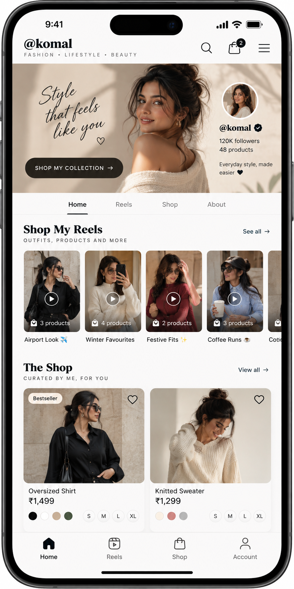

<div align="center">

  

  # Shoboti

  **Creator Commerce Platform**

  *Turn social video content and audience conversations into a direct storefront.*

  <br />

  

  <br />

</div>

---

## What is Shoboti?

Shoboti is an e-commerce platform built for creators who sell through Instagram Reels, direct messages, and WhatsApp. It replaces manual order taking, UPI payment screenshots, and comment chasing with a fast shoppable video storefront and a centralized creator admin panel.

Instead of directing followers to an impersonal website catalogue or answering hundreds of repetitive messages by hand, creators give their audience an interactive, video-first shopping space that feels native to social media.

---

## The Problem

Most social sellers run their business across multiple disconnected apps:

```text
Creator posts a styling Reel
        ↓
Followers comment: "Price?", "Available in M?", "How to order?"
        ↓
Creator copies and pastes responses across dozens of DMs
        ↓
Creator shares personal UPI details
        ↓
Customer transfers money and sends a payment screenshot
        ↓
Creator manually verifies the transaction against bank notifications
        ↓
Creator asks for shipping address in chat and copies it into a spreadsheet
        ↓
Customer repeatedly messages: "Has my parcel shipped?"
```

This routine creates clear bottlenecks:

* **Lost sales from response delays:** Interested buyers move on when direct messages take hours to answer.
* **Payment reconciliation headaches:** Verifying screenshots against bank statements consumes hours and creates fraud risks.
* **Inventory confusion:** Products oversell when stock counts live in notes and spreadsheets.
* **Support overload:** Creators spend more time answering "Where is my order?" than producing content.

---

## Core Use Cases

### 1. Shoppable Video Feed

Customers tap the bio link and immediately enter a full-screen, video-first storefront (`/@creator`). Every outfit, cosmetic, or handcrafted item shown in a Reel is tagged directly on screen. Shoppers can inspect details, choose variants, and add products to their bag without leaving the video experience.

<div align="center">
  
  &nbsp; &nbsp;
  
</div>

<br />

### 2. Direct Checkout Without Payment Screenshots

Shoboti replaces manual UPI screenshot exchanges with an integrated checkout. As soon as a buyer starts checking out, inventory reserves in real time to prevent double-selling. The customer receives instant order confirmation, and the creator receives verified funds.

<div align="center">
  
  &nbsp; &nbsp;
  
</div>

<br />

### 3. The Creator Command Center

Creators get a single operational workbench to manage their entire catalogue, customer records, inventory, and fulfillment pipeline. 

<div align="center">
  
</div>

From this panel, creators can:

* Monitor live revenue, average order value, and order fulfillment status.
* Sync Instagram Reels and tag multiple products per video.
* Update variant inventory with low-stock alerts.
* Bulk import catalogues using validated CSV files.
* Print packing slips and generate shipping labels with pre-filled customer details.

<br />

### 4. Automated Post-Purchase Tracking

Every order generates a live status link sent directly to the customer. Buyers track packing, carrier pickup, transit, and delivery in real time, eliminating repetitive "Where is my parcel?" inquiries in creator DMs.

<br />

### 5. Grounded Storefront Assistant

An integrated shopping assistant answers customer questions around the clock. The assistant references only the creator's real product catalogue, size charts, return policies, and stock levels. It never invents details, giving buyers dependable answers even when the creator is offline.

---

## Feature Overview

| Capability | What it provides |
| :--- | :--- |
| **Social Video Storefront** | Full-screen shoppable Reels, lookbooks, and personalized creator profiles. |
| **Product & Inventory Management** | Variant tracking (size, color, material), stock reservations, and CSV bulk tools. |
| **Content Commerce Tagging** | Multi-product tagging per Reel with direct add-to-cart overlays. |
| **Fulfillment Workbench** | Order status lifecycle, automated packing slips, and carrier integration. |
| **Promotions Engine** | Configurable discount codes with minimum order values and cart thresholds. |
| **Audience Insights** | Revenue tracking that connects specific Reels to actual product sales. |
| **Creator Theme Engine** | Storefront styling adapted to editorial, streetwear, or minimalist creator aesthetics. |

---

## Technical Stack

* **Framework:** Next.js (App Router, React Server Components)
* **Language:** TypeScript
* **Styling:** Tailwind CSS
* **Database & ORM:** PostgreSQL with Drizzle ORM
* **Architecture:** Domain-driven design with isolated provider adapters for payments, shipping, and media

---

## Showcase Assets

All graphic assets, mobile mockups, and logos in this repository are available in the [`assets/`](assets/) directory:

* `assets/logos/`: Official Shoboti logo marks and typography
* `assets/screenshots/`: High-resolution interface captures of the mobile storefront and desktop admin panel
* `assets/banners/`: Brand visuals and platform banners

---

## License

This repository is maintained as a public product showcase. All rights reserved.
