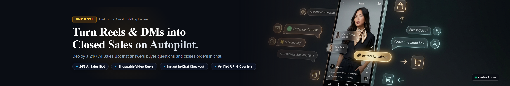
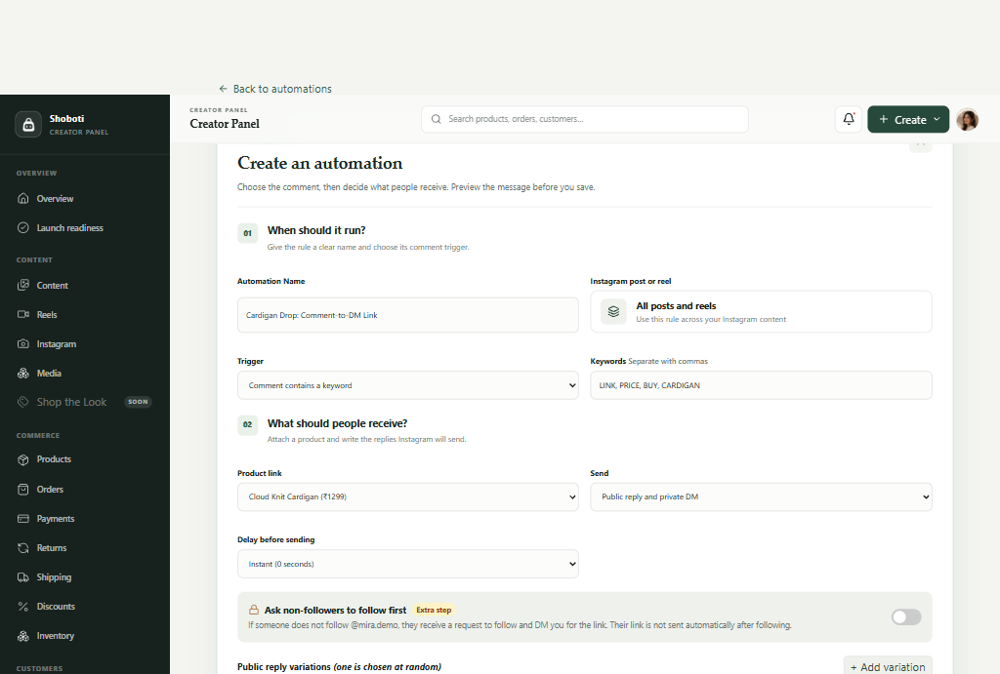
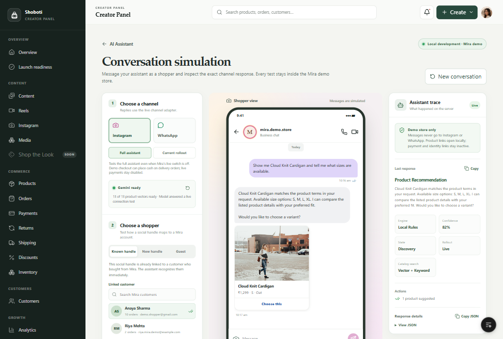
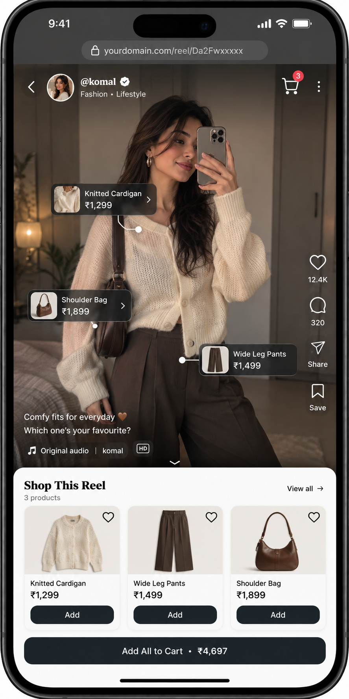
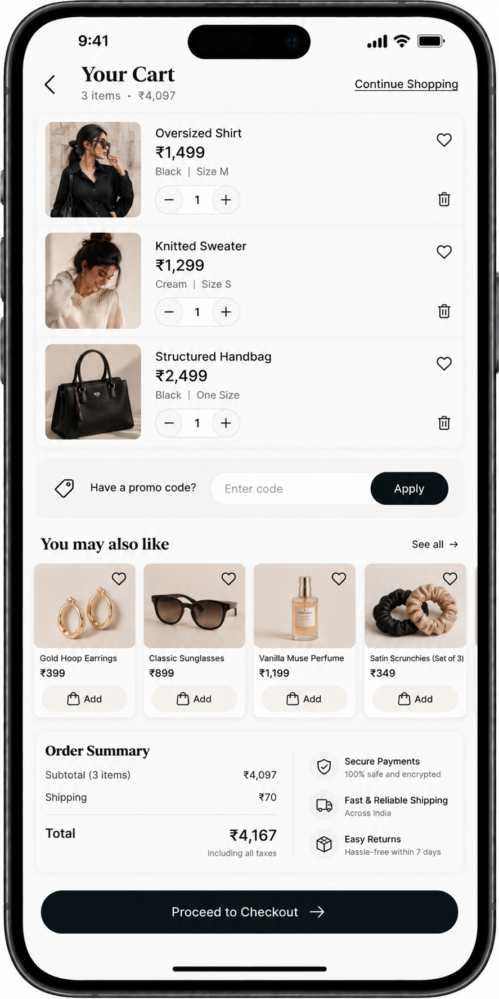
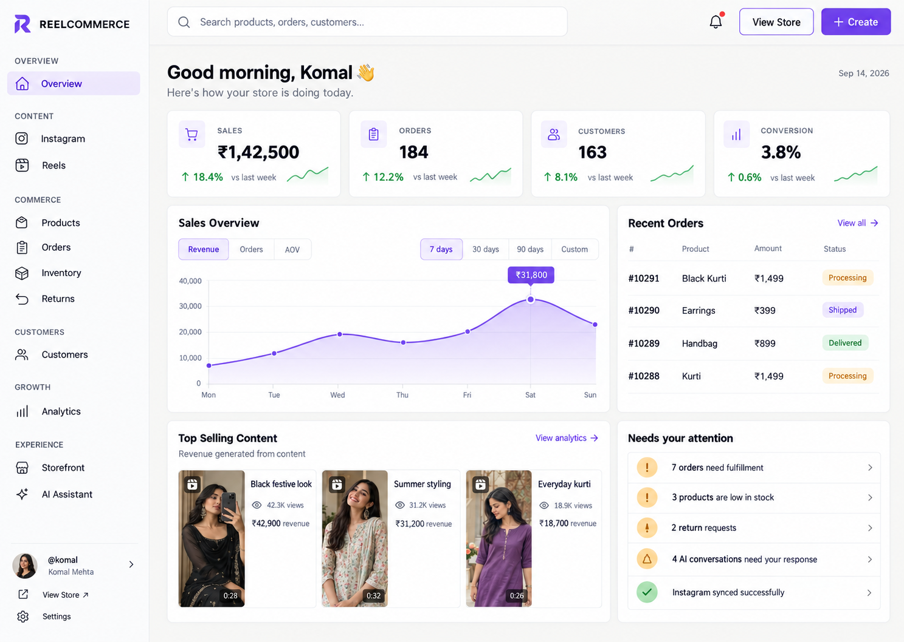

<div align="center">

  <picture>
    <source media="(prefers-color-scheme: dark)" srcset="assets/logos/shoboti-logo-white.png">
    <source media="(prefers-color-scheme: light)" srcset="assets/logos/shoboti-logo-black.png">
    
  </picture>

  <p><strong>Creator Commerce Platform</strong></p>
  <p><em>Turn social video content and direct message conversations into a direct storefront.</em></p>

  <br />

  

  <br />

</div>

---

## What is Shoboti?

Shoboti is an e-commerce platform built for creators who sell through Instagram Reels, direct messages, and WhatsApp. It replaces manual order taking, UPI payment screenshots, and comment chasing with automated social commerce tools and a centralized creator admin panel.

Instead of directing followers to a generic website catalogue or answering hundreds of repetitive messages by hand, creators give their audience an interactive, video-first shopping space connected directly to their Instagram content.

---

## The Problem

Most social sellers run their business across multiple disconnected apps:

```text
Creator drops a styling Reel
        ↓
Followers comment: "Price?", "Available in M?", "How do I order?"
        ↓
Creator copies and pastes responses across dozens of DMs
        ↓
Creator shares personal UPI details
        ↓
Customer transfers money and sends a payment screenshot
        ↓
Creator manually verifies the transaction against bank notifications
        ↓
Creator collects shipping address in chat and copies it into a spreadsheet
        ↓
Customer repeatedly messages: "Has my parcel shipped?"
```

This routine creates clear bottlenecks:

* **Lost sales from response delays:** Interested buyers move on when direct messages take hours to answer.
* **Payment reconciliation headaches:** Verifying screenshots against bank statements consumes hours and creates fraud risks.
* **Inventory confusion:** Products oversell when stock counts live in notes and spreadsheets.
* **Support overload:** Creators spend more time answering "Where is my order?" than producing content.

---

## How Shoboti Solves It: Core Features and Use Cases

### 1. Instagram Comment-to-DM Automation Engine

When creators publish a new Reel, comments like "Price?" or "Link?" flood the post within minutes. Answering them manually takes hours and leads to lost impulse buyers. 

Shoboti automates this entire cycle through a rule-based trigger system directly connected to Instagram:

<div align="center">
  
</div>

<br />

* **Keyword Triggers:** Set rules for specific keywords (such as `LINK`, `PRICE`, `BUY`, or product names), or trigger on any comment across specific posts or all Reels.
* **Rotating Public Replies:** To protect creator accounts from Instagram spam filters, the platform rotates public comment replies automatically (for example: *"Check your DMs! 🛍️ Direct link sent."*, *"Sent to your inbox! ✨"*).
* **Direct DM Dispatch:** The commenter receives a private DM within seconds containing the exact product link, size options, and an optional discount code.
* **Follower Verification:** Optionally gate purchase links so non-followers receive a polite prompt to follow the creator before the checkout link is delivered.
* **Configurable Delays:** Creators can apply natural pauses (2 to 5 seconds) to keep interactions authentic and prevent API throttling.

<br />

### 2. Conversational Commerce and DM Assistant

Customer inquiries continue inside Instagram direct messages and WhatsApp. Buyers frequently ask about fabric details, sizing recommendations, return windows, and order statuses.

Shoboti provides an integrated conversational assistant trained strictly on the creator's product catalogue and store policies:

<div align="center">
  
</div>

<br />

* **Interactive Product Cards in Chat:** When a shopper asks for a recommendation or sizing info, the assistant sends an interactive card with product imagery, pricing, and variant selectors directly inside the chat.
* **Grounded Catalog Vectors:** The assistant references live inventory vectors and store policies. It never invents false product claims or unapproved discounts.
* **Instant Order Tracking in DM:** Customers can check parcel status simply by typing *"Where is my order?"*. The assistant looks up the order history and returns real-time tracking milestones.
* **Simulation and Test Bench:** Creators can test journeys inside the admin panel before turning rules on, verifying exact responses for both Instagram and WhatsApp channels.

<br />

### 3. Shoppable Video Feed and Instant Mobile Checkout

Customers tap the bio link and immediately enter a full-screen, video-first storefront (`/@creator`). Every outfit, cosmetic, or handcrafted item shown in a Reel is tagged directly on screen. Shoppers can inspect details, choose variants, and add products to their bag without leaving the video experience.

<div align="center">
  
  &nbsp; &nbsp;
  
</div>

<br />

* **Zero Payment Screenshots:** Direct checkout collects payments and automatically confirms orders.
* **Real-time Stock Reservations:** Inventory reserves the moment a customer opens checkout, preventing double-selling during drop events.
* **Mobile-First Flow:** Optimized for quick checkout on smartphones, matching social audience browsing habits.

<br />

### 4. Creator Command Center

Creators get a single operational workbench to manage their entire catalogue, customer records, inventory, and fulfillment pipeline.

<div align="center">
  
</div>

<br />

* **Live Sales Overview:** Monitor gross revenue, order fulfillment status, and average order value in real time.
* **Content and Reel Tagging:** Tag multiple catalogue items to any Reel and curate "Shop the Look" bundles.
* **Inventory Control:** Track variant stock (sizes, colors, materials) with low-stock alerts and CSV bulk import tools.
* **Logistics and Shipping:** Generate pre-filled packing slips and carrier shipping labels directly from the order list.

---

## Feature Comparison: Traditional Selling vs. Shoboti

| Workflow Step | Selling on Instagram DMs Manually | Selling with Shoboti |
| :--- | :--- | :--- |
| **Comments on Reels** | Copy-pasting the same reply 100 times | Instant automated reply with rotating anti-spam text |
| **Product Links** | Manually DMing links hours after interest drops | Automated DM sent within 2 seconds with tagged items |
| **Audience Growth** | No mechanism to convert commenters to followers | Optional follow-check gate before link delivery |
| **Payment Collection** | Asking for UPI screenshots and checking bank apps | Direct checkout with verified payment confirmation |
| **Inventory Tracking** | Notes app or memory; frequent overselling | Automated stock reservation during checkout |
| **Post-Purchase Updates** | Manually answering "Where is my parcel?" in DMs | Real-time automated tracking links and in-chat lookup |

---

## Technical Stack

* **Framework:** Next.js (App Router, React Server Components)
* **Language:** TypeScript
* **Styling:** Tailwind CSS
* **Database & ORM:** PostgreSQL with Drizzle ORM
* **AI & Embeddings:** Google Gemini and Llama 3 models with pgvector retrieval
* **Architecture:** Domain-driven design with isolated provider adapters for payments, shipping, and social APIs

---

## Showcase Assets

All graphic assets, mobile mockups, and logos in this repository are available in the [`assets/`](assets/) directory:

* `assets/logos/`: Official Shoboti logo marks (light and dark mode adaptive), wordmarks, and icons
* `assets/screenshots/`: High-resolution interface captures of the automation builder, DM simulation, storefront, and admin panel
* `assets/banners/`: Brand visuals and platform banners

---

## License

This repository is maintained as a public product showcase. All rights reserved.
